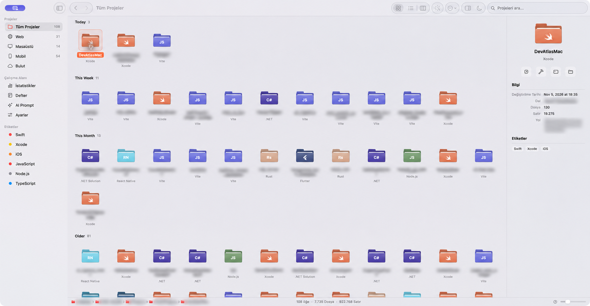
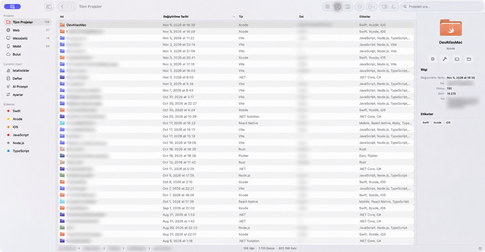
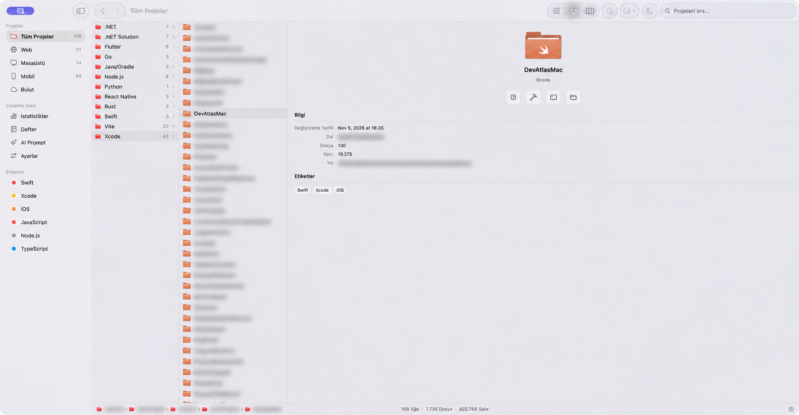
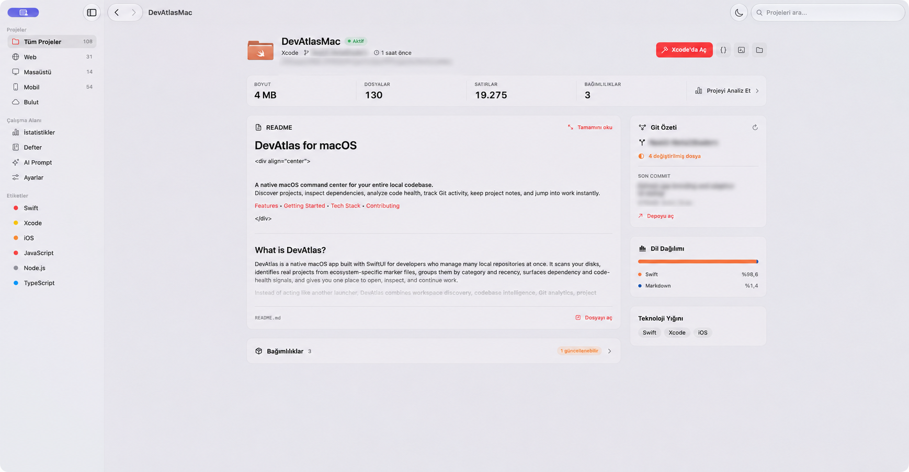
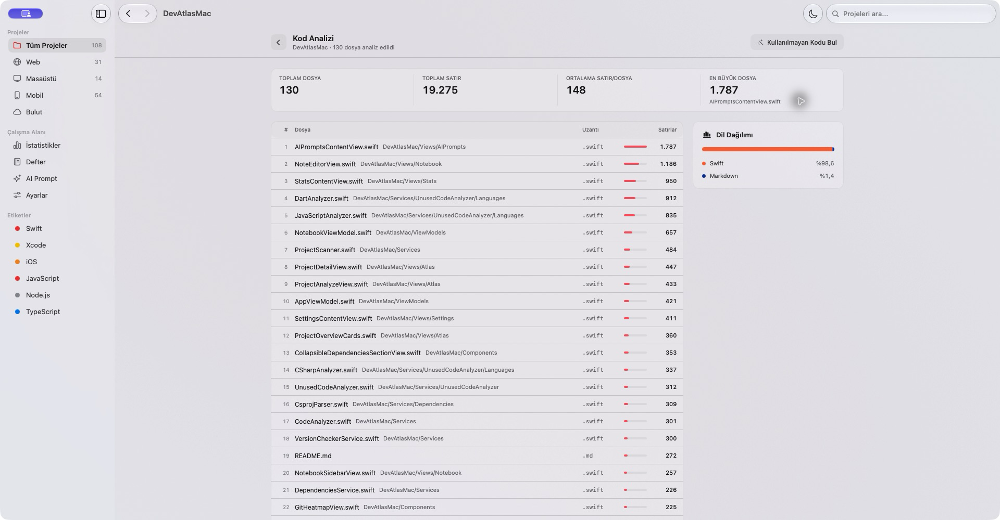
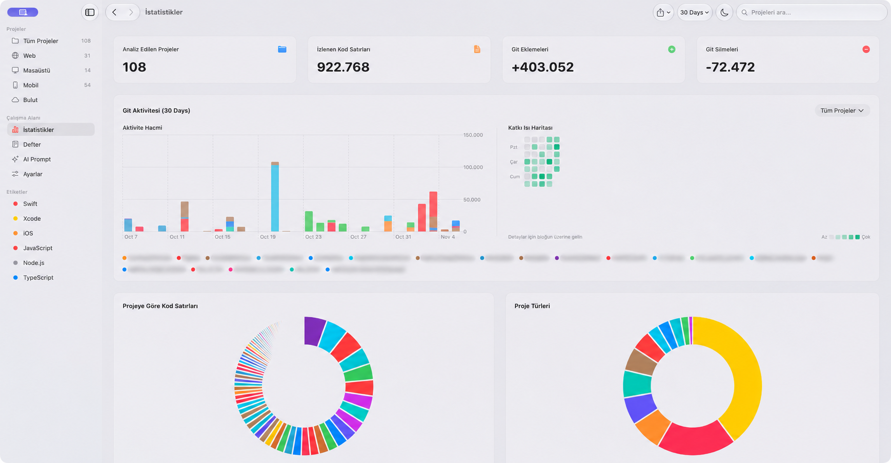
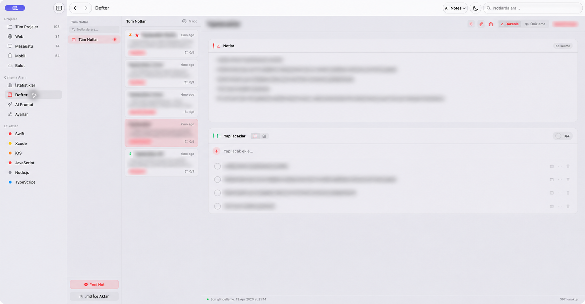
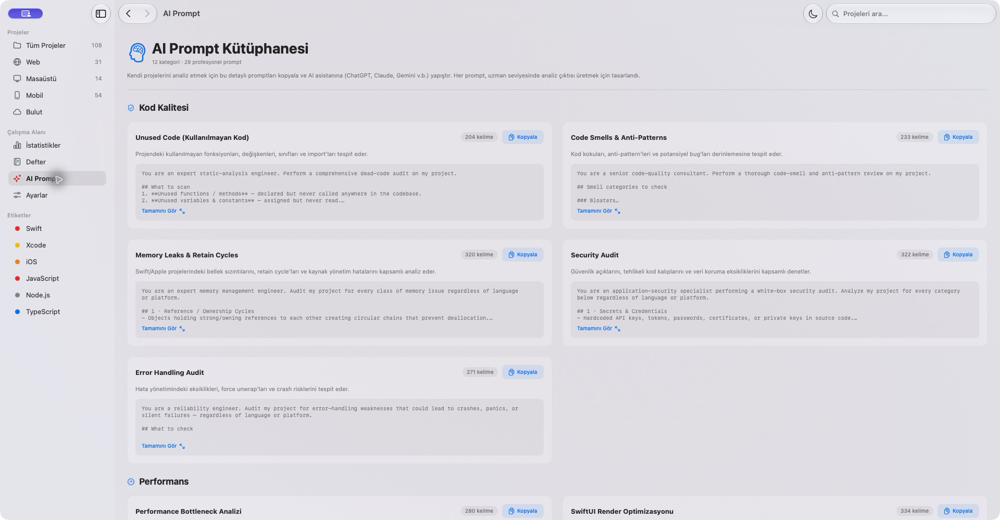
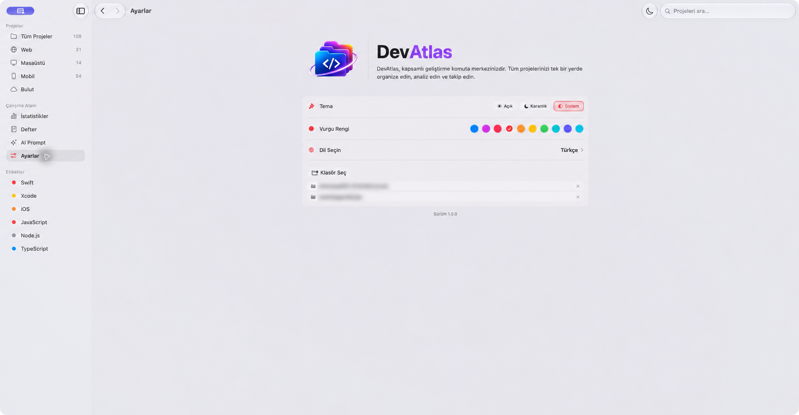

# DevAtlas for macOS

<div align="center">


**A native macOS command center for your entire local codebase.**  
Discover projects, inspect dependencies, analyze code health, track Git activity, keep project notes, and jump into work instantly.

[Screenshots](#screenshots) • [Features](#-features) • [Getting Started](#-getting-started) • [Tech Stack](#-tech-stack) • [Contributing](#-contributing)

</div>

---

## What is DevAtlas?

DevAtlas is a native macOS app built with SwiftUI for developers who manage many local repositories at once. It scans your disks, identifies real projects from ecosystem-specific marker files, groups them by category and recency, surfaces dependency and code-health signals, and gives you one place to open, inspect, and continue work.

Instead of acting like another launcher, DevAtlas combines **workspace discovery**, **codebase intelligence**, **Git analytics**, **project notes**, and **quick actions** in a single desktop app.

## Why It Stands Out

- **Whole-machine project discovery**: scans your home folder and mounted volumes, with smart exclusions and custom ignore paths
- **Polyglot project understanding**: recognizes Swift, Node.js, Flutter, Go, Rust, .NET, Python, Java, Docker, and more from real project markers
- **Built-in dependency visibility**: parses manifests across multiple ecosystems and shows what each project depends on
- **Actionable code insights**: includes unused code analysis, AI prompt workflows, line/file metrics, and Git activity trends
- **Native developer workflow**: open projects in installed editors, Terminal, Finder, or Xcode without leaving the app
- **Finder-style workspace**: browse projects as icons, a sortable list, or columns, with category and tag filters, navigation history, and a preview pane
- **Native rendering**: built with SwiftUI, Swift Charts, and Metal effects, with MarkdownUI for rich Markdown content

## Screenshots

Current app screenshots, captured with the Turkish interface in light appearance. Private project names, local paths, Git details, and note contents are blurred for privacy. Click any image to view it at full size.

### Atlas · Icon View

Browse color-coded project folders grouped by recency. The sidebar filters projects by category or tag; the preview pane shows the selected project's metadata and quick actions.

[](./docs/app.png)

### Atlas · List View

A compact, sortable table shows project names, modification dates, types, Git branches, and tags alongside the project preview.

[](./docs/atlas_list.png)

### Atlas · Column View

Navigate from project type to repository to preview in a three-column browser, with a path bar and workspace totals below.

[](./docs/atlas_columns.png)

### Project Overview

Open a project to read its README, inspect Git status and the latest commit, review its language distribution and dependencies, and launch an editor or terminal.

[](./docs/project_detail.png)

### Code Analysis

Inspect file and line totals, average file size, the largest source files, and language distribution, with access to unused code analysis.

[](./docs/code_analysis.png)

### Stats

Portfolio metrics, Git additions and deletions, activity charts, a contribution heatmap, and project distribution charts share one dashboard. Date filters and CSV export live in the toolbar.

[](./docs/stats.png)

### Notebook

A multi-pane notebook keeps note collections, project-linked notes, the Markdown editor, and todo lists together.

[](./docs/notebook.png)

### AI Prompts

Browse 29 engineering prompts across 12 categories, preview their contents, and copy them into your preferred AI assistant.

[](./docs/ai_prompts.png)

### Settings

Choose light, dark, or system appearance, set an accent color and interface language, and manage folders excluded from scanning.

[](./docs/settings.png)

---

## ✨ Features

### 🔍 Intelligent Project Discovery
DevAtlas's core strength is automatic project indexing across your machine. It scans mounted volumes and your home directory, resolves symlinks, removes duplicates, skips noisy folders, and turns raw directories into a structured project atlas.

- Full-disk recursive scan with smart exclusions (`node_modules`, `.git`, `build`, `dist`, etc.)
- Auto-detects project type from marker files (`package.json`, `go.mod`, `pubspec.yaml`, `Dockerfile`, ...)
- Timeline grouping: **Today**, **This Week**, **This Month**, **Older**
- **Icon, list, and column views** with a shared category and tag sidebar
- Project preview pane with metadata, editor shortcuts, and a clickable path bar
- Back/forward navigation with `⌘[` / `⌘]`
- Live project search with `⌘P` or `⌘F`; toggle the preview pane with `⇧⌘P`
- Custom exclusion paths for personalized scanning

---

### 🤖 AI-Powered Code Analysis
DevAtlas ships with a dedicated prompt workspace for reviewing, refactoring, documenting, and stress-testing your code with external LLMs. The prompts are organized by engineering intent, so the app becomes a practical launchpad for deeper audits instead of a generic prompt list.

#### 📊 Code Quality
| Prompt | Description |
|--------|-------------|
| Unused Code Detection | Comprehensive dead-code audit across your entire project |
| Code Smells | Identify anti-patterns and bloaters (long methods, duplicate code, etc.) |
| Memory Leaks | iOS/macOS-specific memory issue detection |
| Security Audit | White-box security analysis for vulnerabilities |
| Error Handling | Audit error-handling weaknesses that could lead to crashes |

#### ⚡ Performance
| Prompt | Description |
|--------|-------------|
| Bottleneck Analysis | Holistic performance audit with profiling suggestions |
| SwiftUI Render Optimization | View rendering efficiency improvements |
| App Launch Optimization | Minimize time-to-interactive |

#### 🏗️ Architecture
| Prompt | Description |
|--------|-------------|
| Architecture Review | Comprehensive architecture assessment |
| Design Patterns | Pattern usage analysis and opportunities |
| Refactoring Guide | Martin Fowler-based refactoring suggestions |

#### 🧪 Testing
| Prompt | Description |
|--------|-------------|
| Test Coverage Analysis | Identify untested code paths |
| Unit Test Audit | Test quality and reliability review |
| Test Generator | Generate production-quality unit tests |

#### 📚 Documentation
| Prompt | Description |
|--------|-------------|
| API Documentation | DocC-compatible documentation generation |
| README Generator | Complete project documentation |
| Comments Audit | Code comment quality review |

#### 🔧 Other Categories
- **Debugging**: Crash analysis, Xcode Instruments guide
- **Networking**: API audit, mocking setup
- **Accessibility**: WCAG 2.1 AA and Apple HIG compliance
- **Localization**: i18n/l10n audit
- **CI/CD**: Git workflow, pipeline design
- **Dependencies**: Third-party dependency audit
- **Code Generation**: CRUD generator, boilerplate generator

---

### 📦 Dependency Management & Version Checker
Dependency insight is built into the project overview alongside a README preview, Git status, the latest commit, and a language breakdown. DevAtlas parses manifests directly from each repository and aggregates regular, development, and grouped project dependencies where applicable.

| Ecosystem | Manifest File |
|---|---|
| JavaScript / TypeScript | `package.json` |
| Flutter / Dart | `pubspec.yaml` |
| Go | `go.mod` |
| Rust | `Cargo.toml` |
| Swift (SPM) | `Package.swift` |
| Swift (CocoaPods) | `Podfile` |
| Swift (Carthage) | `Cartfile` |
| .NET / C# | `.csproj`, `.sln` |

DevAtlas also checks package versions against upstream registries so outdated dependencies are visible without manually opening each manifest.

---

### 🧹 Unused Code Analyzer
Dead code is technical debt. DevAtlas scans your source files and highlights symbols that are defined but never used:

- **Swift** — functions, classes, structs, enums, variables
- **C#** — unused classes and methods
- **JavaScript / TypeScript** — unreferenced exports and declarations
- **Dart** — unused declarations

> 💡 **Smart Detection**: The unused code analysis button only appears when your project uses a supported language (Swift, C#, JavaScript, or Dart).

---

### 📊 Project Statistics & Git Insights
The stats dashboard turns your local repos into a portfolio-level view. It combines code volume, project mix, and Git contribution history into one interface built with Swift Charts.

- Total file count and **lines of code** per project
- **Git commit history**: commit count, activity graph, lines added/deleted
- Date-range filtering for Git stats
- **Export** statistics as CSV from the toolbar
- Interactive **Charts** for visualizing data

---

### 📝 Notebook
DevAtlas includes a local notebook layer so project context stays attached to the codebase instead of being scattered across separate apps.

- Notes and tasks tied to specific projects
- Full **Markdown rendering**
- Tag and category system for quick filtering
- Cross-project search by content, project, or tag
- Todo items with priority levels and status tracking

---

### ⚡ Quick Actions
Once a project is indexed, DevAtlas is also the fastest way back into it. Quick actions are designed for immediate context switching between discovery and execution.

- **VS Code**, **Xcode**, **Cursor**, **Windsurf**, **Antigravity**
- Open in **Terminal** or **Finder** with one click
- `⌘P` / `⌘F` keyboard shortcuts for instant project search
- Run detected Node-based project scripts directly from the app

---

### 🎨 Native macOS Workspace
- Finder-style sidebar with project counts, category filters, and colored tags
- Unified toolbar with contextual controls, search, and navigation history
- **Icon, list, and column layouts**, an optional preview pane, and a bottom path/status bar
- Metal-rendered folder icons and a subtle animated accent background
- **Light, Dark, and System** appearance with custom accent colors
- Multi-pane notebook and card-based project, statistics, and prompt screens

---

### 🌍 Localization
- Localized UI for English, Turkish, German, French, Italian, Japanese, Korean, and Simplified Chinese
- Language switching built into settings
- Native SwiftUI interface with macOS-first interaction patterns

---

## 🛠 Tech Stack

| Layer | Technology |
|---|---|
| Language | Swift 5.9 |
| UI Framework | SwiftUI 5 |
| Charts & Effects | Swift Charts, Metal shaders |
| Markdown | MarkdownUI (Swift Package Manager) |
| Concurrency | Swift Concurrency (`async/await`, `actor`) |
| State Management | `@Observable` (Observation framework) |
| Minimum OS | macOS 14.0 Sonoma |
| Build Tool | Xcode 15+ |

Apple's native frameworks power the interface, charts, and shader effects. MarkdownUI provides rich Markdown rendering and is resolved through Swift Package Manager.

---

## 🚀 Getting Started

```bash
git clone https://github.com/kodzamani/DevAtlasMac.git
cd DevAtlasMac
open DevAtlasMac.xcodeproj
```

Let Xcode resolve the Swift package dependencies, then press `⌘R` to build and run.

**Requirements:** macOS 14.0 or later · Xcode 15.0 or later

---

## 📁 Project Structure

```
DevAtlasMac/
├── DevAtlasMacApp.swift          # App entry point
├── ContentView.swift             # NavigationSplitView shell & workspace routing
├── Views/
│   ├── Shell/                    # Sidebar & contextual window toolbar
│   ├── Atlas/                    # Icon, list, column, preview & detail views
│   ├── Stats/                    # Statistics dashboard
│   ├── Notebook/                 # Note-taking
│   ├── Settings/                 # App preferences
│   ├── Onboarding/               # First-launch walkthrough
│   └── AIPrompts/                # Curated AI prompt library
├── ViewModels/                   # Business logic & state
├── Services/
│   ├── ProjectScanner.swift      # Disk-scanning engine
│   ├── DependenciesService.swift
│   ├── VersionCheckerService.swift
│   ├── GitStatsService.swift
│   ├── Dependencies/             # Per-ecosystem manifest parsers
│   └── UnusedCodeAnalyzer/       # Static analysis engine
├── Models/                       # Data models
├── Components/                   # Reusable SwiftUI components
│   └── Shaders/                  # Folder icons & animated surfaces
├── Shaders/                      # Metal shader functions
├── Extensions/                   # Swift extensions & helpers
└── *.lproj/                      # Localization strings
```

---

## 🤝 Contributing

Contributions are welcome!

1. Fork the repository
2. Create a feature branch: `git checkout -b feature/your-feature`
3. Commit your changes: `git commit -m 'Add your feature'`
4. Push: `git push origin feature/your-feature`
5. Open a Pull Request

Please open an issue first for significant changes.

---

## 📄 License

This project is licensed under the MIT License.

---

<div align="center">

Built with ❤️ for macOS developers · Native · Fast · No subscriptions

</div>
